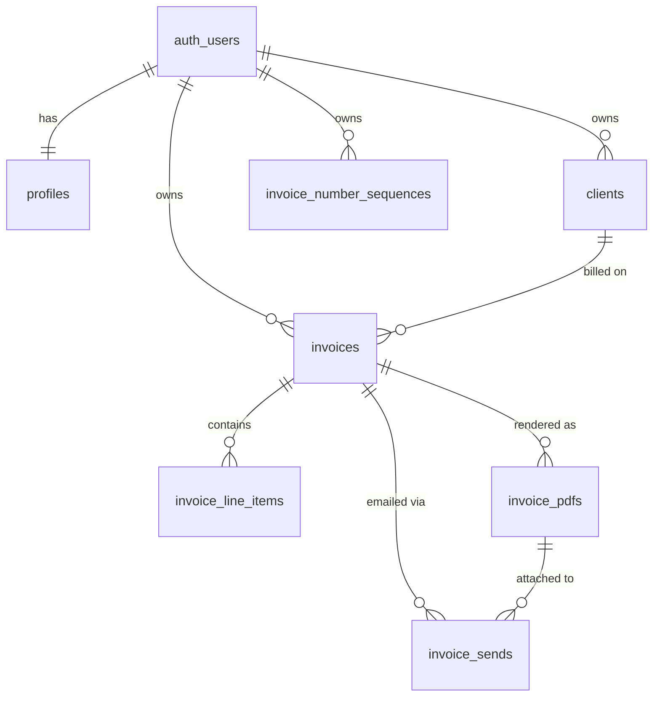

# Invoice Generator — Database Schema

Target: Supabase Postgres **17.6**. Everything below is applied to the project; the
migrations that create it live in `supabase/migrations/`. Product rules come from
[PRD.md](./PRD.md); the surrounding architecture is in [Tech.md](./Tech.md).

## 1. Conventions

- Lowercase `snake_case` for every identifier, so nothing ever needs quoting.
- `timestamptz` for timestamps, `date` for invoice and due dates, `numeric` for money,
  `text` with a `check` constraint instead of Postgres enums (adding a value later is a
  plain constraint change rather than a type migration).
- `uuid` primary keys generated with `gen_random_uuid()`. Ids appear in URLs and in Stripe
  metadata, so sequential integers are undesirable. Random UUIDs cost some index locality,
  which is irrelevant at the scale of one freelancer's invoices; `bigint identity` would be
  the better choice only for very large tables.
- Every foreign key gets an index. Postgres does not create them automatically.
- Row-level security is enabled on every table, with policies that pair
  `to authenticated` with an explicit ownership predicate.
- Ownership is denormalized onto child tables as `user_id` so RLS never needs a join, and
  is kept honest with a composite foreign key back to `invoices (id, user_id)`.

## 2. Entity relationships



`stripe_events` stands alone: it is a webhook de-duplication log with no user-facing rows.

## 3. Tables

### 3.1 `profiles`

One row per account, created automatically on sign-up. Holds the "From" block, the default
email message, and the Stripe Connect account state.

```sql
create table public.profiles (
  id                       uuid primary key references auth.users (id) on delete cascade,

  full_name                text,
  company_name             text,
  email                    text,
  address                  text,
  vat_id                   text,
  website                  text,

  default_email_subject    text,
  default_email_body       text,

  stripe_account_id        text unique,
  stripe_charges_enabled   boolean     not null default false,
  stripe_details_submitted boolean     not null default false,

  created_at               timestamptz not null default now(),
  updated_at               timestamptz not null default now()
);
```

All invoice fields are optional, exactly as the PRD requires. `stripe_charges_enabled` is
the flag the UI uses to decide whether a payment link can be created.

### 3.2 `clients`

```sql
create table public.clients (
  id           uuid primary key default gen_random_uuid(),
  user_id      uuid        not null references auth.users (id) on delete cascade,

  full_name    text,
  company_name text,
  email        text,
  address      text,
  vat_id       text,

  archived_at  timestamptz,

  created_at   timestamptz not null default now(),
  updated_at   timestamptz not null default now()
);

create index clients_user_id_idx on public.clients (user_id);
create index clients_active_idx  on public.clients (user_id, created_at desc)
  where archived_at is null;

create unique index clients_active_email_unique
  on public.clients (user_id, lower(email))
  where archived_at is null and email is not null;
```

Deleting a client sets `archived_at`. Archived clients disappear from the list and from
the invoice dropdown but remain joinable from old invoices. The partial index keeps the
common "my active clients" query cheap. Among clients that are still visible, email
addresses are unique per user without regard to letter case. A blank email is stored as
null and is not part of that rule, so several clients may have no email. An archived
client's email can be used again.

### 3.3 `invoices`

```sql
create table public.invoices (
  id                         uuid primary key default gen_random_uuid(),
  user_id                    uuid        not null references auth.users (id) on delete cascade,
  client_id                  uuid        references public.clients (id) on delete restrict,

  -- document status and payment status are independent
  status                     text        not null default 'draft'
                               check (status in ('draft', 'finalized')),
  payment_status             text        not null default 'unpaid'
                               check (payment_status in ('unpaid', 'paid')),
  paid_source                text        check (paid_source in ('stripe', 'manual')),
  paid_at                    timestamptz,

  -- assigned only at finalization
  invoice_number             text,
  number_year                smallint,
  number_sequence            integer,

  invoice_date               date        not null default current_date,
  due_date                   date        not null default (current_date + 14),
  currency                   text        not null default 'EUR'
                               check (currency in ('EUR', 'USD', 'GBP', 'CHF')),
  tax_rate                   numeric(5,2) not null default 0
                               check (tax_rate >= 0 and tax_rate <= 100),

  subtotal                   numeric(14,2) not null default 0,
  tax_amount                 numeric(14,2) not null default 0,
  total                      numeric(14,2) not null default 0,
  comments                   text,

  -- frozen copy of the profile at finalization
  sender_full_name           text,
  sender_company_name        text,
  sender_email               text,
  sender_address             text,
  sender_vat_id              text,
  sender_website             text,

  -- frozen copy of the client at finalization
  client_full_name           text,
  client_company_name        text,
  client_email               text,
  client_address             text,
  client_vat_id              text,

  stripe_payment_link_id     text,
  stripe_payment_link_url    text,
  stripe_checkout_session_id text,

  content_version            integer     not null default 1,
  finalized_at               timestamptz,
  first_sent_at              timestamptz,
  last_sent_at               timestamptz,
  send_count                 integer     not null default 0,

  created_at                 timestamptz not null default now(),
  updated_at                 timestamptz not null default now(),

  -- lets child tables carry a composite foreign key on (invoice_id, user_id)
  constraint invoices_id_user_key unique (id, user_id),

  constraint invoices_due_after_issue
    check (due_date >= invoice_date),

  constraint invoices_finalized_has_number check (
    (status = 'draft'     and invoice_number is null     and finalized_at is null) or
    (status = 'finalized' and invoice_number is not null and finalized_at is not null)
  ),

  constraint invoices_paid_has_details check (
    (payment_status = 'unpaid' and paid_at is null     and paid_source is null) or
    (payment_status = 'paid'   and paid_at is not null and paid_source is not null)
  ),

  constraint invoices_draft_cannot_be_paid
    check (not (status = 'draft' and payment_status = 'paid'))
);

create unique index invoices_user_number_key
  on public.invoices (user_id, invoice_number)
  where invoice_number is not null;

create index invoices_user_created_idx on public.invoices (user_id, created_at desc);
create index invoices_user_status_idx  on public.invoices (user_id, status, payment_status);
create index invoices_client_id_idx    on public.invoices (client_id);

create unique index invoices_payment_link_idx
  on public.invoices (stripe_payment_link_id)
  where stripe_payment_link_id is not null;

create index invoices_overdue_idx
  on public.invoices (user_id, due_date)
  where status = 'finalized' and payment_status = 'unpaid';
```

Notes on the design:

- The check constraints encode the PRD rules that a draft never has a number, a finalized
  invoice always does, and paid always comes with a timestamp and a source.
- `invoice_number` is unique per user through a partial unique index, so any number of
  drafts can coexist with `null`.
- The `sender_*` and `client_*` columns are the frozen snapshot. They are null while the
  invoice is a draft and filled in by `finalize_invoice()`.
- `client_id` uses `on delete restrict` as a backstop: the application archives clients
  rather than deleting them, and this makes an accidental hard delete fail loudly instead
  of silently orphaning invoices.
- Overdue is derived, never stored:
  `status = 'finalized' and payment_status = 'unpaid' and due_date < current_date`.
  The partial index above serves exactly that filter.
- `invoices_payment_link_idx` is what the webhook uses to find the invoice for an incoming
  `checkout.session.completed` event.

### 3.4 `invoice_line_items`

```sql
create table public.invoice_line_items (
  id          uuid primary key default gen_random_uuid(),
  invoice_id  uuid          not null,
  user_id     uuid          not null,

  position    integer       not null,
  description text          not null default '',
  quantity    numeric(12,2) not null default 1 check (quantity > 0),
  unit_type   text          not null default 'flat'
                check (unit_type in ('hours', 'flat')),
  unit_price  numeric(14,2) not null default 0 check (unit_price >= 0),
  line_total  numeric(14,2) generated always as (round(quantity * unit_price, 2)) stored,

  created_at  timestamptz   not null default now(),
  updated_at  timestamptz   not null default now(),

  constraint invoice_line_items_invoice_fk
    foreign key (invoice_id, user_id)
    references public.invoices (id, user_id) on delete cascade,

  constraint invoice_line_items_position_key
    unique (invoice_id, position) deferrable initially deferred
);

create index invoice_line_items_invoice_idx on public.invoice_line_items (invoice_id);
create index invoice_line_items_user_idx    on public.invoice_line_items (user_id);
```

`line_total` is a stored generated column, so a row can never disagree with its own
arithmetic. The position constraint is deferrable because reordering rows inside one
transaction would otherwise trip the unique check mid-statement.

### 3.5 `invoice_pdfs`

```sql
create table public.invoice_pdfs (
  id           uuid primary key default gen_random_uuid(),
  invoice_id   uuid        not null,
  user_id      uuid        not null,

  version      integer     not null check (version > 0),
  storage_path text        not null unique,
  byte_size    integer,

  created_at   timestamptz not null default now(),

  constraint invoice_pdfs_invoice_fk
    foreign key (invoice_id, user_id)
    references public.invoices (id, user_id) on delete cascade,

  constraint invoice_pdfs_version_key unique (invoice_id, version)
);

create index invoice_pdfs_invoice_idx on public.invoice_pdfs (invoice_id, version desc);
create index invoice_pdfs_user_idx    on public.invoice_pdfs (user_id);
```

Every render adds a row; nothing is overwritten. `storage_path` follows
`{user_id}/{invoice_id}/v{version}.pdf`, which is also what the storage policies match on.
The highest `version` for an invoice is the current document.

### 3.6 `invoice_sends`

```sql
create table public.invoice_sends (
  id                  uuid primary key default gen_random_uuid(),
  invoice_id          uuid        not null,
  user_id             uuid        not null,
  pdf_id              uuid        references public.invoice_pdfs (id) on delete set null,

  to_email            text        not null,
  subject             text        not null,
  body                text        not null,
  payment_link_url    text,

  status              text        not null check (status in ('sent', 'failed')),
  provider_message_id text,
  error_message       text,

  created_at          timestamptz not null default now(),

  constraint invoice_sends_invoice_fk
    foreign key (invoice_id, user_id)
    references public.invoices (id, user_id) on delete cascade
);

create index invoice_sends_invoice_idx on public.invoice_sends (invoice_id, created_at desc);
create index invoice_sends_user_idx    on public.invoice_sends (user_id);
create index invoice_sends_pdf_idx     on public.invoice_sends (pdf_id);
```

This is the send history behind "sent on ... , 2 times" on the invoice detail screen, and
it records failures so the user can see why an email did not go out.

### 3.7 `invoice_number_sequences`

```sql
create table public.invoice_number_sequences (
  user_id     uuid     not null references auth.users (id) on delete cascade,
  year        smallint not null,
  last_number integer  not null default 0 check (last_number >= 0),

  primary key (user_id, year)
);
```

A per-user, per-year counter. A Postgres sequence cannot be used here because numbering
restarts each year, is scoped per user, and must not advance on rollback.

### 3.8 `stripe_events`

```sql
create table public.stripe_events (
  id           text primary key,          -- Stripe event id, evt_...
  type         text        not null,
  account_id   text,                      -- connected account from event.account
  payload      jsonb,
  received_at  timestamptz not null default now(),
  processed_at timestamptz
);
```

The primary key is the de-duplication guarantee: the webhook inserts first, and a
unique-violation means the event has already been handled. Only the service role touches
this table.

## 4. Functions and triggers

### 4.1 `updated_at` maintenance

```sql
create or replace function public.tg_set_updated_at()
returns trigger
language plpgsql
set search_path = ''
as $$
begin
  new.updated_at := now();
  return new;
end;
$$;

create trigger profiles_set_updated_at
  before update on public.profiles
  for each row execute function public.tg_set_updated_at();

create trigger clients_set_updated_at
  before update on public.clients
  for each row execute function public.tg_set_updated_at();

create trigger invoices_set_updated_at
  before update on public.invoices
  for each row execute function public.tg_set_updated_at();

create trigger invoice_line_items_set_updated_at
  before update on public.invoice_line_items
  for each row execute function public.tg_set_updated_at();
```

### 4.2 Profile creation on sign-up

```sql
create or replace function public.handle_new_user()
returns trigger
language plpgsql
security definer
set search_path = ''
as $$
begin
  insert into public.profiles (id, email)
  values (new.id, new.email);
  return new;
end;
$$;

revoke execute on function public.handle_new_user() from public, anon, authenticated;

create trigger on_auth_user_created
  after insert on auth.users
  for each row execute function public.handle_new_user();
```

This is one of the few justified uses of `security definer`: the trigger fires in the
`auth` schema during sign-up, when no `authenticated` role exists yet. Execute permission
is revoked from every public role so it cannot be called as an API endpoint, and
`search_path = ''` forces fully qualified names.

### 4.3 Totals recalculation

```sql
create or replace function public.recalculate_invoice_totals(p_invoice_id uuid)
returns void
language sql
set search_path = ''
as $$
  update public.invoices i
     set subtotal   = t.subtotal,
         tax_amount = round(t.subtotal * i.tax_rate / 100, 2),
         total      = t.subtotal + round(t.subtotal * i.tax_rate / 100, 2)
    from (
      select coalesce(sum(line_total), 0) as subtotal
        from public.invoice_line_items
       where invoice_id = p_invoice_id
    ) t
   where i.id = p_invoice_id;
$$;

create or replace function public.tg_line_items_recalculate()
returns trigger
language plpgsql
set search_path = ''
as $$
begin
  perform public.recalculate_invoice_totals(coalesce(new.invoice_id, old.invoice_id));
  return null;
end;
$$;

create trigger invoice_line_items_recalculate
  after insert or update or delete on public.invoice_line_items
  for each row execute function public.tg_line_items_recalculate();

create or replace function public.tg_invoice_recalculate()
returns trigger
language plpgsql
set search_path = ''
as $$
begin
  perform public.recalculate_invoice_totals(new.id);
  return null;
end;
$$;

create trigger invoices_tax_rate_recalculate
  after update of tax_rate on public.invoices
  for each row when (old.tax_rate is distinct from new.tax_rate)
  execute function public.tg_invoice_recalculate();
```

The rounding order matches the application: line totals are rounded first (by the
generated column), the subtotal is the sum of rounded line totals, and tax is rounded
once. The tax-rate trigger does not recurse, because the update it performs never touches
`tax_rate`.

### 4.4 Finalization and numbering

```sql
create or replace function public.finalize_invoice(p_invoice_id uuid)
returns public.invoices
language plpgsql
set search_path = ''
as $$
declare
  v_invoice public.invoices;
  v_profile public.profiles;
  v_client  public.clients;
  v_year    smallint;
  v_seq     integer;
begin
  select * into v_invoice
    from public.invoices
   where id = p_invoice_id
     for update;

  if not found then
    raise exception 'Invoice not found' using errcode = 'no_data_found';
  end if;
  if v_invoice.status <> 'draft' then
    raise exception 'Invoice is already finalized' using errcode = 'check_violation';
  end if;
  if v_invoice.client_id is null then
    raise exception 'Invoice has no client' using errcode = 'check_violation';
  end if;
  if not exists (select 1 from public.invoice_line_items where invoice_id = p_invoice_id) then
    raise exception 'Invoice has no line items' using errcode = 'check_violation';
  end if;

  v_year := extract(year from v_invoice.invoice_date)::smallint;

  insert into public.invoice_number_sequences (user_id, year, last_number)
       values (v_invoice.user_id, v_year, 1)
  on conflict (user_id, year)
  do update set last_number = public.invoice_number_sequences.last_number + 1
    returning last_number into v_seq;

  select * into v_profile from public.profiles where id = v_invoice.user_id;
  select * into v_client  from public.clients  where id = v_invoice.client_id;

  update public.invoices set
      status              = 'finalized',
      finalized_at        = now(),
      number_year         = v_year,
      number_sequence     = v_seq,
      invoice_number      = v_year::text || '-' || lpad(v_seq::text, 4, '0'),
      sender_full_name    = v_profile.full_name,
      sender_company_name = v_profile.company_name,
      sender_email        = v_profile.email,
      sender_address      = v_profile.address,
      sender_vat_id       = v_profile.vat_id,
      sender_website      = v_profile.website,
      client_full_name    = v_client.full_name,
      client_company_name = v_client.company_name,
      client_email        = v_client.email,
      client_address      = v_client.address,
      client_vat_id       = v_client.vat_id
    where id = p_invoice_id
  returning * into v_invoice;

  return v_invoice;
end;
$$;
```

The function is `security invoker`, so row-level security still applies: a user calling it
with someone else's invoice id gets "Invoice not found" because the `select ... for update`
returns nothing. The `insert ... on conflict do update ... returning` locks the counter row
for the duration of the transaction, which is what makes concurrent finalization safe.

### 4.5 Locking paid invoices

```sql
create or replace function public.tg_invoices_block_paid_changes()
returns trigger
language plpgsql
set search_path = ''
as $$
declare
  v_mutable_keys text[] := array[
    'payment_status', 'paid_at', 'paid_source',
    'stripe_payment_link_id', 'stripe_payment_link_url', 'stripe_checkout_session_id',
    'first_sent_at', 'last_sent_at', 'send_count', 'updated_at'
  ];
begin
  if old.payment_status = 'paid' and new.payment_status = 'paid' then
    if (to_jsonb(new) - v_mutable_keys) is distinct from (to_jsonb(old) - v_mutable_keys) then
      raise exception 'A paid invoice cannot be edited'
        using errcode = 'check_violation';
    end if;
  end if;
  return new;
end;
$$;

create trigger invoices_block_paid_changes
  before update on public.invoices
  for each row execute function public.tg_invoices_block_paid_changes();

create or replace function public.tg_line_items_block_when_paid()
returns trigger
language plpgsql
set search_path = ''
as $$
declare
  v_paid boolean;
begin
  select payment_status = 'paid' into v_paid
    from public.invoices
   where id = coalesce(new.invoice_id, old.invoice_id);

  if coalesce(v_paid, false) then
    raise exception 'Line items of a paid invoice cannot be changed'
      using errcode = 'check_violation';
  end if;

  return coalesce(new, old);
end;
$$;

create trigger invoice_line_items_block_when_paid
  before insert or update or delete on public.invoice_line_items
  for each row execute function public.tg_line_items_block_when_paid();
```

Edit locking lives in the database rather than only in the UI, so a direct `POST` to a
server action cannot bypass it. Re-sending a paid invoice and reverting it to unpaid both
remain possible, which is exactly the behaviour the PRD asks for. Deleting a paid invoice
is blocked separately, by the RLS policy below.

## 5. Row-level security

Enable RLS everywhere first:

```sql
alter table public.profiles                 enable row level security;
alter table public.clients                  enable row level security;
alter table public.invoices                 enable row level security;
alter table public.invoice_line_items       enable row level security;
alter table public.invoice_pdfs             enable row level security;
alter table public.invoice_sends            enable row level security;
alter table public.invoice_number_sequences enable row level security;
alter table public.stripe_events            enable row level security;
```

### 5.1 `profiles`

```sql
create policy profiles_select_own on public.profiles
  for select to authenticated
  using ((select auth.uid()) = id);

create policy profiles_update_own on public.profiles
  for update to authenticated
  using ((select auth.uid()) = id)
  with check ((select auth.uid()) = id);
```

No insert or delete policy: rows are created by the sign-up trigger and removed by the
cascade when the auth user is deleted.

### 5.2 `clients`

```sql
create policy clients_select_own on public.clients
  for select to authenticated
  using ((select auth.uid()) = user_id);

create policy clients_insert_own on public.clients
  for insert to authenticated
  with check ((select auth.uid()) = user_id);

create policy clients_update_own on public.clients
  for update to authenticated
  using ((select auth.uid()) = user_id)
  with check ((select auth.uid()) = user_id);

create policy clients_delete_own on public.clients
  for delete to authenticated
  using ((select auth.uid()) = user_id);
```

### 5.3 `invoices`

```sql
create policy invoices_select_own on public.invoices
  for select to authenticated
  using ((select auth.uid()) = user_id);

create policy invoices_insert_own on public.invoices
  for insert to authenticated
  with check ((select auth.uid()) = user_id);

create policy invoices_update_own on public.invoices
  for update to authenticated
  using ((select auth.uid()) = user_id)
  with check ((select auth.uid()) = user_id);

create policy invoices_delete_unpaid on public.invoices
  for delete to authenticated
  using ((select auth.uid()) = user_id and payment_status <> 'paid');
```

### 5.4 Invoice children

The same shape repeats for `invoice_line_items`, `invoice_pdfs`, and `invoice_sends`,
matching on the denormalized `user_id`:

```sql
create policy invoice_line_items_select_own on public.invoice_line_items
  for select to authenticated using ((select auth.uid()) = user_id);

create policy invoice_line_items_insert_own on public.invoice_line_items
  for insert to authenticated with check ((select auth.uid()) = user_id);

create policy invoice_line_items_update_own on public.invoice_line_items
  for update to authenticated
  using ((select auth.uid()) = user_id)
  with check ((select auth.uid()) = user_id);

create policy invoice_line_items_delete_own on public.invoice_line_items
  for delete to authenticated using ((select auth.uid()) = user_id);

-- PDFs and send records are append-only from the user's side
create policy invoice_pdfs_select_own on public.invoice_pdfs
  for select to authenticated using ((select auth.uid()) = user_id);

create policy invoice_pdfs_insert_own on public.invoice_pdfs
  for insert to authenticated with check ((select auth.uid()) = user_id);

create policy invoice_sends_select_own on public.invoice_sends
  for select to authenticated using ((select auth.uid()) = user_id);

create policy invoice_sends_insert_own on public.invoice_sends
  for insert to authenticated with check ((select auth.uid()) = user_id);
```

### 5.5 `invoice_number_sequences`

```sql
create policy invoice_number_sequences_select_own on public.invoice_number_sequences
  for select to authenticated using ((select auth.uid()) = user_id);

create policy invoice_number_sequences_insert_own on public.invoice_number_sequences
  for insert to authenticated with check ((select auth.uid()) = user_id);

create policy invoice_number_sequences_update_own on public.invoice_number_sequences
  for update to authenticated
  using ((select auth.uid()) = user_id)
  with check ((select auth.uid()) = user_id);
```

Needed because `finalize_invoice()` runs as the calling user.

### 5.6 `stripe_events`

RLS is enabled and **no policies are created**, so no client role can read or write it.
The service role bypasses RLS, which is how the webhook handler reaches it.

### 5.7 Why these policies look the way they do

- `auth.uid()` is wrapped in a subselect so the planner evaluates it once per query rather
  than once per row.
- Update policies always carry both `using` and `with check`; without `with check` a user
  could move a row to another `user_id`.
- `to authenticated` on its own would be authentication without authorization, so every
  policy also has an ownership predicate.
- Every column used in a policy (`user_id`, `id`) is indexed.
- `auth.role()` is deliberately not used anywhere; it is deprecated and breaks if
  anonymous sign-ins are ever enabled.

## 6. Storage

```sql
insert into storage.buckets (id, name, public)
values ('invoice-pdfs', 'invoice-pdfs', false);

create policy invoice_pdf_objects_select_own on storage.objects
  for select to authenticated
  using (
    bucket_id = 'invoice-pdfs'
    and (storage.foldername(name))[1] = (select auth.uid())::text
  );

create policy invoice_pdf_objects_insert_own on storage.objects
  for insert to authenticated
  with check (
    bucket_id = 'invoice-pdfs'
    and (storage.foldername(name))[1] = (select auth.uid())::text
  );
```

The bucket is private and served through signed URLs. Paths are
`{user_id}/{invoice_id}/v{version}.pdf`, so the first path segment is the ownership check.
Only `select` and `insert` are granted, because each render writes a new version instead of
overwriting; if upsert is ever introduced, an `update` policy becomes necessary too, since
Supabase Storage upsert silently fails without all three.

## 7. Example queries

**Invoice list page, 20 per page, with the overdue flag**

```sql
select i.id, i.invoice_number, i.invoice_date, i.due_date, i.currency, i.total,
       i.status, i.payment_status,
       (i.status = 'finalized'
        and i.payment_status = 'unpaid'
        and i.due_date < current_date) as is_overdue,
       coalesce(i.client_company_name, i.client_full_name, c.company_name, c.full_name)
         as client_label
  from public.invoices i
  left join public.clients c on c.id = i.client_id
 where i.user_id = $1
 order by i.created_at desc
 limit 20 offset $2;
```

The snapshot columns are preferred and the live client is only a fallback for drafts, which
have no snapshot yet. For deep pages, switch from `offset` to keyset pagination on
`(created_at, id)`.

**Dashboard figures in a single pass**

```sql
select
  coalesce(sum(total) filter (where payment_status = 'paid'), 0)   as total_paid,
  coalesce(sum(total) filter (where payment_status = 'unpaid'), 0) as total_outstanding,
  coalesce(sum(total) filter (
    where payment_status = 'unpaid' and due_date < current_date), 0) as total_overdue,
  count(*) filter (where status = 'finalized')                     as invoices_issued
  from public.invoices
 where user_id = $1
   and status = 'finalized';
```

**Webhook resolving an invoice from a payment link**

```sql
select id, user_id, total, currency, payment_status
  from public.invoices
 where stripe_payment_link_id = $1;
```

## 8. Migration order

```
supabase/migrations/
  0001_profiles.sql              table, trigger on auth.users, RLS
  0002_clients.sql
  0003_invoices.sql              invoices + line items + generated column
  0004_invoice_documents.sql     invoice_pdfs, invoice_sends
  0005_invoice_numbering.sql     sequences table + finalize_invoice()
  0006_invoice_totals.sql        recalculation function and triggers
  0007_paid_invoice_locks.sql    edit-locking triggers
  0008_stripe_events.sql
  0009_storage.sql               bucket + object policies
  0010_clients_active_email_unique.sql
```

After applying them:

1. Run the Supabase advisors and clear anything they flag.
2. Confirm that newly created tables are actually exposed to the Data API. Depending on
   the project's Data API settings, `anon` and `authenticated` may need explicit `grant`
   statements; RLS controls which rows are visible, not whether a table is reachable.
3. Generate TypeScript types into `lib/database.types.ts` and wire them into the Supabase
   clients.
